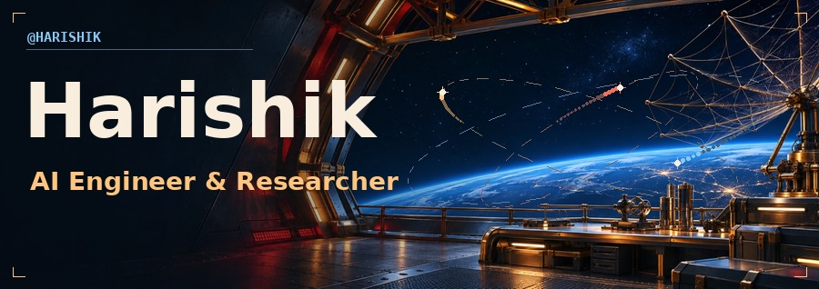
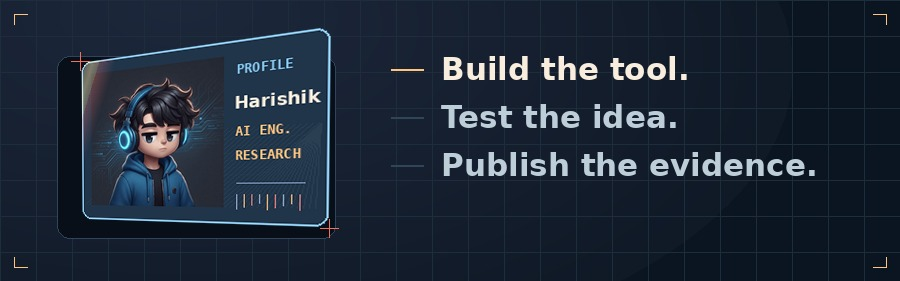
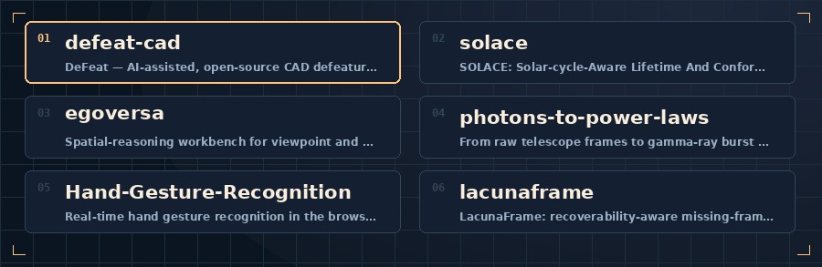
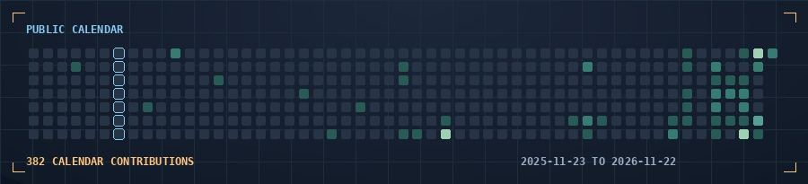

# Harishik

**AI Engineer & Researcher** · [GitHub](https://github.com/Harishik) · [ORCID](https://orcid.org/0009-0007-6781-2803) · [LinkedIn](https://www.linkedin.com/in/harishik-dev-singh-jamwal-b31b60288/) · [Motion edition](README.md)

[Selected work](#selected-work) · [Project index](#project-index) · [Pinned work](#pinned-work) · [Contribution replay](#contribution-replay)

## About

I build AI systems and engineering tools, and publish research on how models perform under changing conditions.

## Selected work

- [**EgoVersa**](https://github.com/Harishik/egoversa) — Spatial-reasoning workbench for viewpoint and perspective-taking in vision-language models · Updated 2026-11-22
- [**DeFeat**](https://github.com/Harishik/defeat-cad) — DeFeat — AI-assisted, open-source CAD defeaturing for simulation (STEP in, simulation-ready STEP + stress check + report + code out) · Updated 2026-11-20
- [**LacunaFrame**](https://github.com/Harishik/lacunaframe) — LacunaFrame: recoverability-aware missing-frame recovery for video. LacunaNet is a hybrid network (differentiable Lucas–Kanade motion prior + learned corrections) that r… · Updated 2026-11-22
- [**SOLACE**](https://github.com/Harishik/solace) — SOLACE: Solar-cycle-Aware Lifetime And Conformal Estimation — calibrated re-entry and debris-risk forecasting under solar-cycle uncertainty · Updated 2026-11-22
- [**Photons to Power Laws**](https://github.com/Harishik/photons-to-power-laws) — From raw telescope frames to gamma-ray burst physics: image subtraction, PSF photometry, multi-instrument light curves through real filter curves, power-law and afterglo… · Updated 2026-10-12

## Project index

- [**EgoVersa**](https://github.com/Harishik/egoversa) — Spatial reasoning
- [**DeFeat**](https://github.com/Harishik/defeat-cad) — Engineering tools
- [**LacunaFrame**](https://github.com/Harishik/lacunaframe) — Video recovery
- [**SOLACE**](https://github.com/Harishik/solace) — Orbital forecasting
- [**Photons to Power Laws**](https://github.com/Harishik/photons-to-power-laws) — Gamma-ray burst analysis
- [**Feature Space Stability**](https://doi.org/10.3390/math14061082) — MRI model generalization
- [**Autonomous Disaster Reconnaissance**](https://doi.org/10.3390/telecom7020031) — Published robotics survey

### Recently updated repositories

- [**clipstudio**](https://github.com/Harishik/clipstudio) — Updated 2026-11-21
- [**Balloon-Shooter**](https://github.com/Harishik/Balloon-Shooter) — Updated 2026-11-11
- [**Hand-Gesture-Recognition**](https://github.com/Harishik/Hand-Gesture-Recognition) — Updated 2026-11-11
- [**Improving-Cross-Domain-Generalization-in-Brain-MRIs-via-Feature-Space-Stability-Regularization**](https://github.com/Harishik/Improving-Cross-Domain-Generalization-in-Brain-MRIs-via-Feature-Space-Stability-Regularization) — Updated 2026-10-09

## Pinned work

- [**defeat-cad**](https://github.com/Harishik/defeat-cad) — DeFeat — AI-assisted, open-source CAD defeaturing for simulation (STEP in, simulation-ready STEP + stress check + report + code out)
- [**solace**](https://github.com/Harishik/solace) — SOLACE: Solar-cycle-Aware Lifetime And Conformal Estimation — calibrated re-entry and debris-risk forecasting under solar-cycle uncertainty
- [**egoversa**](https://github.com/Harishik/egoversa) — Spatial-reasoning workbench for viewpoint and perspective-taking in vision-language models
- [**photons-to-power-laws**](https://github.com/Harishik/photons-to-power-laws) — From raw telescope frames to gamma-ray burst physics: image subtraction, PSF photometry, multi-instrument light curves through real filter curves, power-law and afterglo…
- [**Hand-Gesture-Recognition**](https://github.com/Harishik/Hand-Gesture-Recognition) — Real-time hand gesture recognition in the browser: 33 gestures, both hands tracked in 3D, trained on 1.3M hands (HaGRIDv2), fully on-device. MediaPipe + PyTorch MLPs + T…
- [**lacunaframe**](https://github.com/Harishik/lacunaframe) — LacunaFrame: recoverability-aware missing-frame recovery for video. LacunaNet is a hybrid network (differentiable Lucas–Kanade motion prior + learned corrections) that r…

## Contribution replay

Calendar window: 2025-11-23 to 2026-11-22 · **45 active days** · **382 public calendar contributions**.

_Project media comes from the public repository documentation. The observatory and cassette artwork is AI-generated._
